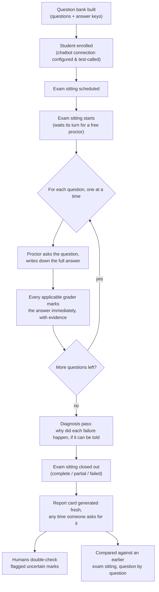

# How It Works, in Plain English

This is the friendly version of [docs/technical-flow.md](technical-flow.md). That document is
written for someone reading the source code alongside it — class names, table names, method
names. This one is for someone who wants to actually understand what the tool *does* and *why*,
without needing a programming background. No code, no jargon left unexplained.

**The one idea to hold onto:** this tool gives a chatbot an exam. It asks it a fixed set of
questions it already knows the right answers to, writes down everything the chatbot said and
did, has several independent graders mark each answer, and keeps a strict paper trail of every
mark and every grader's reasoning so nothing gets lost or quietly changed later. Everything
below is that idea, worked out in detail.

---

## 1. The cast of characters

Before the story, here's who's involved. Each row also gives the actual database table it's
stored in — every one of these is a real table you can go look at yourself (see §5) — so you
don't have to take the plain-English description on faith.

| In plain English | What it actually is | The actual database table(s) |
|---|---|---|
| **The question bank** | A set of exam questions, each with a correct-answer key attached | `evaluation_dataset` (the bank itself), `evaluation_test_case` (one row per question) |
| **The student** | The chatbot being tested, plus instructions for how to send it questions | `target_system` |
| **One exam sitting** | One complete attempt at running the whole question bank against the student | `evaluation_run` |
| **One question attempt** | One specific question, asked once, with the student's answer written down | `test_execution` |
| **A grader** | A rule, or a second AI, whose only job is to mark one narrow aspect of one answer | not a table — graders are pieces of logic built into the tool itself |
| **One grader's mark** | One grader's verdict on one answer: pass, fail, "couldn't grade," or "not applicable here" | `evaluation_metric_result` |
| **The exam board's diagnosis** | A write-up of *why* an answer failed, built from one or more graders' marks plus evidence | `evaluation_finding` |
| **A teacher's double-check** | A human looking at an uncertain or high-stakes mark and confirming, overturning, or flagging it | `human_review` |
| **The report card** | The full write-up of one exam sitting: scores, examples, diagnoses, recommendations | not a table — freshly built from all of the above every time it's opened (see Step 8) |
| **Comparing two terms' results** | Lining up this exam sitting against an earlier one, question by question | not a table — freshly built by reading two `evaluation_run`s' worth of data at once |
| **A recycled old transcript** (Step 10) | One previously captured question/answer, fed in without a live student to ask | `imported_trace` |
| **The consultant's default write-up per diagnosis category** | Editable boilerplate recommendation text, one per diagnosis category | `recommendation_template` |

Two housekeeping details worth knowing before you go looking yourself: every ID in every table
is a long random code (a UUID, e.g. `7e4f1c2a-...`), never a small counting number — you'll get
these back from the tool itself (an API response, or the report) rather than guessing them. And
every table has `created_at`/similar timestamp columns, so "what happened most recently" is
always a real, sortable question.

---

## 2. The journey of one exam sitting

### Step 1 — Build the question bank

Someone (a consultant, in practice) writes a batch of questions, each with: the question itself,
what a correct answer should contain, anything the answer must *never* say, which source
document should have been used, whether the question is a trick question that should be
politely declined, and how serious a wrong answer would be. This whole batch is uploaded in one
go and locked — once it's marked "ready to use," nobody can quietly edit a question underneath a
result that already used it. If someone needs to change a question later, they write a new
version of the question bank instead of editing the old one in place, so nobody accidentally
rewrites the exam after it's already been graded.

> **Where this lives:** one new row in `evaluation_dataset` (the bank's name and status), plus
> one new row in `evaluation_test_case` per question. "Locking" the bank is just that row's
> `status` column changing from `DRAFT` to `READY` — a plain value the rest of the tool checks
> before it will let anything use the bank.

### Step 2 — Enroll the student

The tool is told how to actually talk to the chatbot: what web address to send questions to,
what the request needs to look like, and where in the chatbot's reply to find the actual answer
(versus, say, a list of source documents it says it used). If the chatbot needs a password to
talk to, the tool is told *the name of* the password, not the password itself — it reads the
real value from the computer's own environment only at the exact moment it needs to send a
question, and never writes it down anywhere. Before running the full question bank, there's a
one-question dry run — send it one sample question and check the reply actually came back in the
shape expected — specifically so a typo in the setup doesn't waste an entire exam sitting.

> **Where this lives:** one new row in `target_system`. Look at the row's columns yourself and
> you'll see exactly why no password ever leaks: there is a column for the *name* of the
> environment variable holding the password, but literally no column that could hold the
> password's actual value — it isn't that the value is hidden, it's that there's nowhere to put
> it even by mistake. The one-question dry run doesn't write anything to the database at all —
> it's a live call made and thrown away on the spot, purely to show you the result.

### Step 3 — Schedule and start the exam sitting

An exam sitting is created (which question bank, which student, how many times to ask each
question — asking each question more than once is how the tool later catches a chatbot that's
"right on average but unreliable question to question"). Starting it doesn't happen instantly:
the sitting first goes into a waiting line and only actually begins once a free "proctor" picks
it up.

There are only **two proctors** on duty at any time (that number is a deliberate setting, not a
hard limit of the software — it can be turned up). If both are busy running other exam sittings,
a new one waits in line rather than starting immediately. This matters because of the next step.

> **Where this lives:** one new row in `evaluation_run`, with a `status` column that you can
> literally watch change over the row's lifetime: `CREATED` → `QUEUED` → `RUNNING` → and finally
> `COMPLETED`, `PARTIALLY_COMPLETED`, or `FAILED`. If you ever want to know "is my exam sitting
> actually doing anything," this one column is the entire answer — see the debugging cookbook in
> §5.

### Step 4 — One proctor asks every question, one at a time

Here's the detail that surprises people: **one exam sitting is handled by exactly one proctor,
and that proctor asks its questions strictly one after another — never several at once.** It
asks a question, waits for the full answer (or a timeout, or an error), writes everything down,
hands that one answer straight to the graders, waits for them to finish, and only then moves to
the next question. A "how many questions can run at the same time" setting on the student exists,
but it only matters when *two different exam sittings* happen to be questioning the *same*
student at the *same* moment — it does nothing to speed up a lone exam sitting.

For every single question, the proctor writes down, permanently: the exact question asked, the
chatbot's full answer, any source citations or retrieved documents it referenced, how long it
took to answer, whether it succeeded or errored out (timed out, server error, gave back
gibberish instead of an answer), and — if the setup allows it — the raw technical reply
underneath the friendly version. This written record is never edited later; if something needs
correcting, a new record is added, the old one stays exactly as it was captured.

> **Where this lives:** the question bank's questions get one new row each in `test_execution`
> for this sitting *before* any question is actually asked (all sitting `status = PENDING`), so
> you can already count how many questions this sitting has even while it's still running. As
> the proctor works through them, each row's `status` moves `PENDING` → `RUNNING` → a final state
> (`SUCCEEDED`, `TIMED_OUT`, `TARGET_ERROR`, or `INVALID_RESPONSE`), and the same row picks up the
> `answer`, `citations`, `retrieved_chunks`, and `latency_milliseconds` columns as the real
> answer comes back. This is the single most useful table to look at when you want to see
> "what did the chatbot actually say" — see §5.

### Step 5 — Every answer gets marked by several independent graders, immediately

The moment one answer is written down, it's handed straight to every grader that applies to
that kind of question — not batched up and marked later. There are two kinds of grader:

- **Checklist graders** — fast, mechanical, no ambiguity: "does the answer contain this exact
  required phrase," "does it avoid this forbidden phrase," "did a citation get returned when the
  policy requires one," "was the expected source document actually retrieved." These never call
  out to any AI; they're plain rule-checking.
- **AI teaching-assistant graders** — a second, *local* AI model (never sent over the internet)
  reads the question, the answer, and the source material, and gives a structured, explained
  verdict: is this answer actually backed up by the retrieved material, does it match the known
  correct answer, does it cover everything it should, is it relevant at all. This AI grader is
  explicitly told that everything it's reading is untrusted content to be *evaluated*, not
  instructions to be *followed* — so a cleverly worded chatbot answer can't trick the grader into
  ignoring its job.

Every single grader, for every single question, produces exactly one of four outcomes — and the
system is very strict about never blurring these together:

1. **The student got it wrong** — a real, counted failure.
2. **The student got it right** — a real, counted pass.
3. **The grader itself couldn't do its job** — for example, the local AI grader wasn't running.
   This is *never* counted as the chatbot's fault, and it's kept completely separate from real
   failures so a broken grader can never make the chatbot look worse than it is.
4. **This grader didn't apply to this question at all** — for example, a citation-checking
   grader has nothing to check on a question the chatbot didn't answer.

Some marks are automatically flagged for a human to double-check later — a grader wasn't very
confident, two graders disagreed with each other, the question was high-stakes, or the grader's
output looked malformed. Flagging doesn't block anything; the exam sitting keeps moving.

> **Where this lives:** one new row in `evaluation_metric_result` per grader, per question
> attempt — so if nine checklist graders and one AI grader both applied to a question, that's ten
> rows from this one question alone. The four outcomes in the list above are literally two
> columns working together: a `status` column that is exactly one of `COMPLETED` / `FAILED` /
> `SKIPPED` (this is where "grader itself broke" vs. "not applicable" are kept from ever being
> confused), and — only when `status = COMPLETED` — a `passed` column that's the real pass/fail
> verdict. Every row also has an `evidence` column holding the grader's actual reasoning in
> structured form (which chunk it looked at, which phrase it matched, what the AI grader said and
> why) — this is the column to read when a mark seems surprising. The "flag for a human"
> mentioned above is just another column on this same row, `requires_human_review`, set to true
> or false.

### Step 6 — Diagnose *why*, not just *that*, something failed

Once every question has been asked and marked, a separate pass looks at the pattern of marks on
each answer and tries to explain *why* it failed, not just record that it did. This is where the
tool is most careful: it will only name a specific cause (the source document wasn't found at
all; the source document was found but a worse one was used instead; the answer contradicted its
own source material; the chatbot refused a question it shouldn't have, or answered one it should
have refused) **when the evidence actually supports that specific explanation**. When an answer
is clearly wrong but the available evidence doesn't point at one specific cause, the tool says
exactly that — "something is wrong here, but the cause can't be determined from what we can see
from the outside" — instead of guessing just to fill in a field. This honest "we don't know" is a
deliberate feature, not a gap: the alternative (silently picking a plausible-sounding cause) would
be actively misleading.

This diagnosis pass also compares repeated attempts at the same question against each other, to
catch a chatbot that gave meaningfully different answers (a different number, a different named
person, a different level of refusal) across repeats — small wording differences don't count,
only differences that would actually matter to someone reading the answer.

> **Where this lives:** one new row in `evaluation_finding` per diagnosis reached. Its `category`
> column is exactly one of a fixed list — things like "the source document was never found,"
> "the answer disagreed with its own source," "the system should have refused and didn't" — and
> when nothing fits, the honest `UNKNOWN` category, never a forced guess. A `supporting_metric_
> result_ids` column lists exactly which `evaluation_metric_result` rows this diagnosis was built
> from, so you can always trace a diagnosis back to the specific grader marks that produced it.
> One detail worth knowing if you're poking around: every time this diagnosis pass runs (which
> happens again on a resumed sitting), it first deletes all of this sitting's old `evaluation_
> finding` rows and writes fresh ones — so this table never accumulates stale duplicates, but it
> also means you should never expect an `evaluation_finding` row's `id` to stay stable across a
> resume.

### Step 7 — The exam sitting closes out

The sitting is marked as fully completed if every question got a real answer attempt; partially
completed if some questions errored out at the connection level but others succeeded (still
enough to report on); or failed outright if nothing came back at all. This status is never
sugar-coated — a partially completed sitting is reported as exactly that, with the failed
questions called out separately from the ones that were actually judged on quality.

> **Where this lives:** the same `evaluation_run` row from Step 3 gets its `status` column set to
> its final value here, plus a `completed_at` timestamp. Nothing new is created at this point —
> it's purely the last update to a row you've been able to watch the whole time.

### Step 8 — Read the report card

Nothing about the report card is written in advance. The moment someone asks to see the scores,
or opens the full report, or asks for a specific summary, the tool goes back to the permanent
written records from Steps 4–6 and tallies everything fresh, on the spot. This means the report
can never go stale or drift out of sync with the underlying data — there's nothing cached that
could disagree with it. It also means a rate like "correct-refusal rate" is only ever shown when
there were actually refusal questions to measure it on; if there weren't any, the tool shows "not
applicable," never a made-up zero.

The full report card reads like an actual audit document: an executive summary, a breakdown by
how serious the failures were, worked examples of the most important failures (the actual
question, the actual wrong answer, the actual evidence, in full), a section specifically for
things that couldn't be evaluated and why, prioritized recommendations, and a methodology section
explaining exactly what each grader can and can't tell you.

> **Where this lives:** nothing — and that's the whole point of this step. There is no
> "report" table anywhere in the database. Opening the report re-reads `evaluation_run`,
> `test_execution`, `evaluation_metric_result`, `evaluation_finding`, `human_review`, and
> `recommendation_template` fresh, every single time, and does all the counting in that moment.
> If you're ever suspicious that a report looks wrong, there is nothing to invalidate or clear —
> the very next page load re-derives it from scratch from whatever those tables currently say.

### Step 9 — A human double-checks the uncertain marks

Anything flagged in Step 5 sits in a queue for a person to look at. A reviewer reads the full
context — the question, the answer, every grader's reasoning — and records a decision: confirm
the automated mark, overturn it, mark it genuinely uncertain, or say it needs a specialist. **The
original automated mark is never erased or rewritten** — the human's decision is recorded
*alongside* it, so the report can always show both "what the automated graders said" and "what a
human ultimately decided," side by side, forever. If a human confirms a mark that a diagnosis in
Step 6 was resting on, that diagnosis gets marked as human-confirmed too.

> **Where this lives:** one new row in `human_review` per decision — it points at the
> `evaluation_metric_result` row it's reviewing, but that row itself is never touched or updated.
> If the same mark is reviewed more than once (say, an uncertain first pass, then a specialist's
> confirmed decision later), you'll simply see more than one `human_review` row pointing at the
> same mark — that accumulation *is* the audit trail, not a bug to clean up. Confirming a
> diagnosis just flips one column, `human_confirmed`, on the relevant `evaluation_finding` row.

### Step 10 — Two different ways to reuse old answers

Sometimes you want to re-mark old answers without asking the chatbot the questions all over
again — maybe the grading rubric changed, or the local AI grader wasn't running the first time
and you want those marks filled in now. There are two distinct ways this happens:

- **Re-grading a past exam sitting**: every already-written-down answer from an earlier sitting
  is copied over as-is, and the *current* graders mark it fresh. The chatbot is never contacted
  again — this works even if the chatbot's access credentials have since expired.
- **Importing an old transcript**: if you have chatbot conversations captured from *before* this
  tool was ever involved (production logs, say), you can feed those in directly as if they were
  a normal exam sitting's answers. The tool treats a supplied transcript exactly like a live
  answer for grading purposes — same graders, same diagnosis, same report — it just skipped the
  step of actually asking the question itself.

> **Where this lives:** re-grading creates a new `evaluation_run` row plus new `test_execution`
> rows that each point back at the original answer's `test_execution` row via a
> `source_execution_id` column — so the new rows are recognizably copies, not fresh answers.
> Importing an old transcript is different under the hood even though it looks similar from the
> outside: it also creates a new `evaluation_run` and new `test_execution` rows, but each new
> execution is additionally paired 1-to-1 with a row in `imported_trace` holding the transcript
> content you supplied — the tool reads that row back the moment it would otherwise have made a
> live call.

### Step 11 — What happens if the power goes out mid-exam

Because every step writes its result down immediately (Step 4/5), an exam sitting interrupted by
a crash or restart never loses data silently. On restart, the tool checks for any sitting that
was left "in progress" with no proctor actually working on it anymore, and honestly relabels it
"interrupted" — it never quietly pretends to resume something it can't verify. A person can then
explicitly say "continue this sitting," at which point only the questions that never got a real
answer are attempted again — anything that already succeeded, or already failed with a real
recorded error, is left alone.

> **Where this lives:** on restart, the tool looks for any `evaluation_run` row still showing
> `RUNNING` or `QUEUED` — a status that can only mean "a process that no longer exists was
> working on this" — and sets it to `INTERRUPTED`, while any of that sitting's `test_execution`
> rows still stuck on `RUNNING` get set to `CANCELLED`. Resuming re-queues the sitting and resets
> exactly those `CANCELLED` rows back to `PENDING`; every other row is left completely alone.

### Step 12 — Throwing away an old exam sitting

Deleting an exam sitting deletes everything that came from it — every written-down answer, every
grader's mark, every human review, every diagnosis — in one action. The one exception: if a later
sitting re-graded some of this sitting's answers (Step 10), that copy is left in place; only the
link back to "which original sitting this came from" is cleared.

> **Where this lives:** deleting the one `evaluation_run` row is genuinely the only command the
> tool itself issues — the database is set up so that removing that row automatically removes
> every `test_execution`, `evaluation_metric_result`, `human_review`, `evaluation_finding`, and
> `imported_trace` row that pointed at it (this is a database feature called a cascading delete,
> not application code looping over tables). The one exception mirrors Step 10's
> `source_execution_id` column: deleting the original sitting just clears that column on any
> copy rather than deleting the copy too.

### Step 13 — Comparing this sitting to an earlier one

Two exam sittings can be lined up against each other, question by question, matched by the
question's permanent ID (never by position or wording — so reordering or rewording the question
bank doesn't break the comparison). Each question is labeled as newly added, removed, improved,
regressed, unchanged, or "can't tell" (if either sitting didn't produce a clean pass/fail for it).
Rates, high-severity failure counts, and typical answer time are compared side by side.

Critically, if the two sittings didn't use identical graders (say, the local AI grader's version
changed in between), the comparison says so loudly, in plain terms, above every single number —
because a "better" score caused by a looser grader isn't actually an improvement, and presenting
it as one would be worse than not comparing at all.

> **Where this lives:** nothing, again — same as the report card in Step 8, this reads two
> `evaluation_run`s' worth of `test_execution`/`evaluation_metric_result`/`evaluation_finding`
> rows on demand and lines them up in memory, matched by each question's `external_id` value
> (the permanent ID from `evaluation_test_case`, not the row's own database ID — the row ID
> changes bank to bank, `external_id` doesn't).

---

## 3. A few "why"s worth knowing

- **Why does one proctor ask questions one at a time instead of all at once?** Simplicity and
  predictability were chosen over raw speed for this first version — a strictly ordered exam
  sitting is much easier to reason about, resume correctly after a crash, and audit later. Speed
  can come from running more proctors, not from making one proctor juggle several questions at
  once.
- **Why is nothing pre-calculated?** So the report can never lie by being stale. A cached number
  that quietly drifts out of sync with the real records is a subtle, hard-to-catch kind of bug;
  recomputing everything from the permanent written records every time removes the possibility
  entirely.
- **Why keep the human's decision separate from the automated mark instead of just overwriting
  it?** So there's always a complete, honest history — anyone reading the report later can see
  both what the automated graders concluded and what a person decided, rather than only ever
  seeing whichever one happened to be typed in most recently.
- **Why say "we don't know" instead of always giving a specific cause?** Because this tool can
  only see what the chatbot sends back over the wire — it doesn't get to look inside the
  chatbot's own search index or its internal instructions. Naming a specific cause when the
  visible evidence doesn't actually support one would just be a confident-sounding guess wearing
  the costume of a finding.

---

## 4. The whole journey, as one picture



---

## 5. Look inside it yourself: a beginner's guide to debugging with the database

Everything above names real tables on purpose, so you can go check any of it rather than trust
the description. This section is the practical "how" — the actual commands, explained one piece
at a time, assuming you've never run a database command before.

### 5.1 Connect to the database

The workbench's database runs inside Docker (started with `docker compose up -d postgres`). To
open an interactive session inside it:

```bash
docker compose exec postgres psql -U rageval -d rageval
```

Read that as: "run a command (`exec`) inside the already-running `postgres` container, and the
command is `psql` (Postgres's own command-line tool), connecting as the user `rageval` to the
database also called `rageval`." Those credentials are defined in `compose.yaml` — nothing to
look up, they're always the same on a local setup. You'll land on a `rageval=#` prompt. From
here on, every command below is typed at that prompt and ends with a semicolon.

If you'd rather use a graphical tool (TablePlus, DBeaver, Postico, the database panel in an
IDE), point it at `localhost:5432`, database `rageval`, user `rageval`, password `rageval` — same
credentials, just a window instead of a prompt. Either way works for everything below; a GUI is
often nicer for browsing, `psql` is nicer for quick one-off questions.

Three words you'll see in every command: `SELECT` means "show me," `FROM <table>` means "out of
this table," `WHERE <condition>` means "only rows matching this." `ORDER BY ... LIMIT 5` means
"sort them, and only show me the first five." That's genuinely enough SQL to follow every example
below.

### 5.2 Get an ID to investigate

Almost every query below needs a specific ID (a run's ID, an execution's ID) to look at. You get
these the same way you'd get them normally — from the API response when you created or started
something, or from the report page's URL, or, if you've lost track, by just asking the database
what exists:

```sql
SELECT id, name, status, created_at FROM evaluation_run ORDER BY created_at DESC LIMIT 5;
```

This alone answers a lot of "what's going on" questions: are there runs you forgot about, is the
one you care about even in the list, what status is it actually in right now.

### 5.3 A debugging cookbook, question by question

| What you're wondering | What to run |
|---|---|
| "Is my exam sitting actually doing anything, or is it stuck?" | `SELECT status FROM evaluation_run WHERE id = '<run id>';` — if this says `QUEUED` for a long time, both worker "proctors" are busy elsewhere; if it says `RUNNING` and isn't moving, check the application's own logs next, not the database. |
| "How far through the questions has it gotten?" | `SELECT status, count(*) FROM test_execution WHERE evaluation_run_id = '<run id>' GROUP BY status;` — this groups every question attempt by its current status and counts them, so you get something like `SUCCEEDED: 4, PENDING: 2`. |
| "What did the chatbot actually say to one specific question?" | `SELECT answer, http_status, error_type, error_message FROM test_execution WHERE id = '<execution id>';` — if `answer` is empty, the other three columns tell you why (timeout, server error, bad response shape). |
| "Which grader failed this answer, and why did it fail it?" | `SELECT evaluator_key, status, passed, explanation FROM evaluation_metric_result WHERE test_execution_id = '<execution id>';` — one row per grader; read `explanation` for the human-readable reasoning. |
| "I want the AI grader's full reasoning, not just the summary." | `SELECT evaluator_key, evidence FROM evaluation_metric_result WHERE test_execution_id = '<execution id>' AND evaluator_type = 'LLM';` — `evidence` is structured detail: which chunk it looked at, what it concluded about each claim, and so on. |
| "Did a grader fail to run at all — is that why a score looks off?" | `SELECT evaluator_key, status, error_message FROM evaluation_metric_result WHERE test_execution_id = '<execution id>' AND status = 'FAILED';` — a non-empty result here means a grader broke, which (by design) is never held against the chatbot. |
| "What's the overall diagnosis for this exam sitting?" | `SELECT category, severity, title, summary FROM evaluation_finding WHERE evaluation_run_id = '<run id>' ORDER BY severity DESC;` |
| "Has anyone reviewed this uncertain mark yet?" | `SELECT decision, reviewer_name, comment, reviewed_at FROM human_review WHERE metric_result_id = '<metric result id>';` — an empty result means: not reviewed yet. |
| "How many questions are still waiting for a grader?" | `SELECT count(*) FROM test_execution te WHERE te.evaluation_run_id = '<run id>' AND te.status IN ('SUCCEEDED','TIMED_OUT','TARGET_ERROR','INVALID_RESPONSE') AND NOT EXISTS (SELECT 1 FROM evaluation_metric_result mr WHERE mr.test_execution_id = te.id);` — this is a slightly more advanced query (it's asking "which finished questions have zero grader marks"), but it's the exact question you want answered if a report looks incomplete. |
| "Is the local AI grader (Ollama) even reachable right now?" | Not a database question — check `curl http://127.0.0.1:8080/actuator/health` instead; look for the `evaluatorModel` component. If it's down, every `evaluation_metric_result` row with `evaluator_type = 'LLM'` for anything run since will show `status = 'FAILED'`, which is exactly the previous row's query confirming it from the data side. |

### 5.4 A worked example — chasing one confusing result

Say a report shows a question as `INCONCLUSIVE` instead of a clean pass or fail, and you want to
know why. Here's the actual trail:

1. Find the question's execution: `SELECT id FROM test_execution WHERE evaluation_run_id = '<run id>' AND test_case_id = (SELECT id FROM evaluation_test_case WHERE external_id = 'YOUR-QUESTION-ID' AND dataset_id = '<dataset id>');`
2. Look at every grader's mark on it: `SELECT evaluator_key, status, passed FROM evaluation_metric_result WHERE test_execution_id = '<execution id from step 1>';`
3. `INCONCLUSIVE` almost always means at least one grader shows `status = 'FAILED'` here rather
   than `COMPLETED` — that's your answer: a grader broke on this question (commonly: the local AI
   grader wasn't reachable), not that the chatbot actually failed anything.
4. To confirm, check `error_message` on that same row for exactly what went wrong.

That four-step trail — execution → its marks → the one that's off → its own explanation column —
is the same pattern for almost any "why did this happen" question you'll ever have about a
result. Once it's familiar, you genuinely don't need this document anymore to debug the tool.

---

## 6. Bridge to the technical version

Once this makes sense, `technical-flow.md` covers the same journey again, but names the actual
code that runs at each step (not just the tables), the exact request/response shapes involved,
and the concurrency model in full — useful once you're ready to read or modify the code itself.
