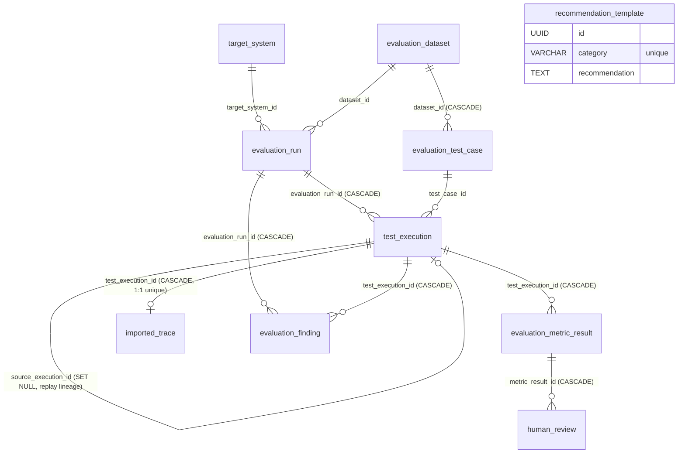
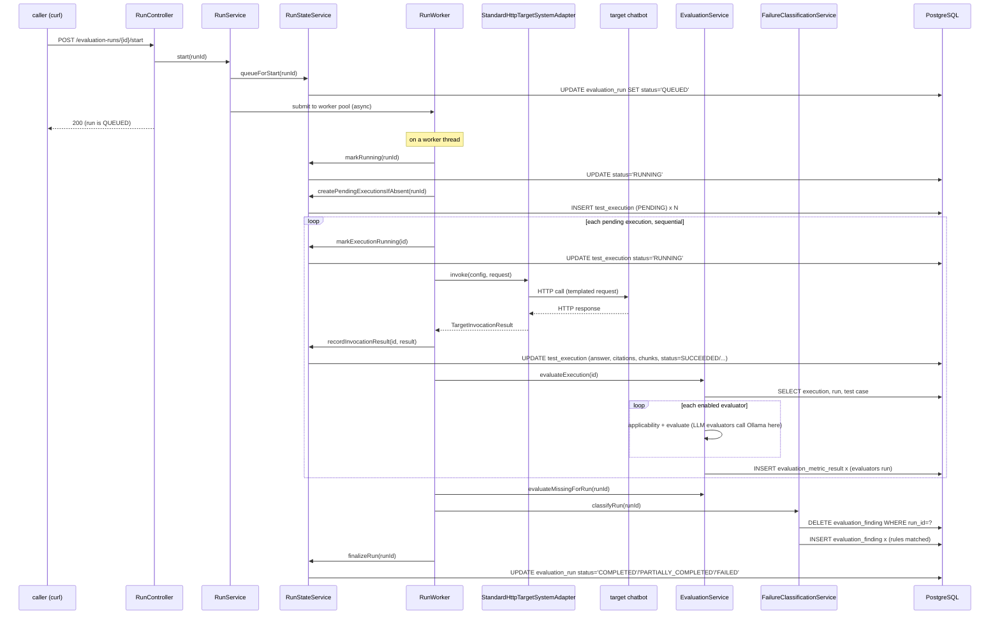

# Technical Deep Dive: How the Workbench Actually Works

**Scope note before you read this.** You asked for the technical flow "when white-box testing a
chatbot" — this document instead traces the technical internals of the system **as it actually
exists today**, which only does black-box evaluation (see [docs/white-box-roadmap.md](white-box-roadmap.md)
for what white-box testing would require and why it isn't built). That's almost certainly what
you actually want here: every fact below — table names, method names, call order — is read
directly from the source in this repository, not summarized from the other docs. If you did mean
something else by "white-box testing," say so and this can be redirected.

Every claim in this document is grounded in a specific file. Where it matters, the file is named
so you can go verify it yourself — that's the point of a document like this.

---

## 1. Module architecture, restated precisely

One Spring Boot application, one Postgres database, one dependency direction:

```
report → comparison → review → classification → evaluation → run → target
                                                          (all) → dataset, common, configuration
```

Two things about this graph matter for everything below:

- **`run` does not depend on `evaluation` or `classification`**, even though a run's worker calls
  evaluation and classification code on every execution. This is resolved by dependency
  inversion: `run.application.EvaluationPipeline` is an interface **owned by `run`**, and
  `classification.application.DeterministicEvaluationPipeline` (which *does* depend downward on
  both `evaluation` and `run`) implements it and is injected into `RunWorker`/`RunService` by
  Spring. `run` never imports a class from `evaluation` or `classification` — it only knows the
  interface it declared for itself.
- **Nothing is precomputed.** There is no summary table, no materialized view, no cached
  aggregate anywhere in this schema. Every rate, count, comparison, and report is recomputed from
  the base tables (§2) on every read. This is a deliberate consequence of "no score without
  evidence, no hidden staleness" — see §5.

---

## 2. The schema, table by table

Eleven Liquibase-managed tables (`src/main/resources/db/changelog/changes/001`–`013`). All
primary keys are application-generated UUIDs (never `SERIAL`/`IDENTITY` — the app decides IDs
before persisting, per `CLAUDE.md`).



| Table | Written by | Purpose |
|---|---|---|
| `target_system` | `TargetSystemService.create/update` | The chatbot's HTTP contract: endpoint, method, request template (JSONB), four response JSON-pointers, auth type + secret **env var name** (never a value — no column exists that could hold one), timeouts, concurrency, `response_mapping` (JSONB: token/citation/chunk field overrides). |
| `evaluation_dataset` | `DatasetImportService.persist` / `DatasetService` | Name, version, `status` (`DRAFT`→`READY`→`ARCHIVED`, enforced by a `CHECK` constraint). |
| `evaluation_test_case` | `DatasetImportService.persist` | One question + ground truth. `required_facts`, `forbidden_claims`, `expected_document_ids`, `tags`, `user_context` are all JSONB. Unique constraint on `(dataset_id, external_id)` — this is the join key comparisons use later. |
| `evaluation_run` | `RunService.create` / `.replay` / `ImportedTraceImportService.doImport` | One evaluation attempt. `status` (8-value enum, `CHECK`-constrained), `run_mode` (`LIVE`/`REPLAY`), `repetitions_per_test_case`, `enabled_evaluator_keys` (JSONB list — empty means "all registered"), `evaluator_configuration` (JSONB overrides), `@Version` optimistic-lock column. |
| `test_execution` | `RunStateService.createPendingExecutionsIfAbsent` (insert), then `.recordInvocationResult`/`.copyFromSourceExecution` (update) | One (test case × repetition) attempt. Carries the entire captured evidence: `request_payload`, `answer`, `raw_response`, `citations`, `retrieved_chunks` (all JSONB), `target_model`, `latency_milliseconds`, tokens, `http_status`, `error_type`/`error_message`, `status` (7-value `CHECK`-constrained state machine). `source_execution_id` self-references this same table — set only on true-replay executions (§6), `ON DELETE SET NULL` so deleting the original run doesn't cascade-delete the replay's own copied data. |
| `evaluation_metric_result` | `EvaluationService.evaluateExecution` (`saveAll`, once per enabled evaluator per execution) | One evaluator's verdict on one execution: `evaluator_key`, `evaluator_type` (`DETERMINISTIC`/`LLM`/`HUMAN`/`AGGREGATED`), `evaluator_version`, `evaluator_model`/`prompt_version` (LLM only), `status` (`COMPLETED`/`SKIPPED`/`FAILED` — the three-way verdict made literal as a `CHECK` constraint), `passed`, `score` (0–1, `CHECK`-constrained), `confidence` (0–1), `evidence` (JSONB array of `EvaluationEvidence`), `requires_human_review`. **`ON DELETE CASCADE` from `test_execution`.** |
| `human_review` | `HumanReviewService.submit` | One append-only decision row per review: `decision` (4-value `CHECK`), `override_passed`/`override_score`, `reviewer_name`, `comment`. **Never updates or deletes an `evaluation_metric_result` row** — this table exists specifically so the automated verdict is physically untouched. `ON DELETE CASCADE` from `evaluation_metric_result`. |
| `evaluation_finding` | `FailureClassificationService.classifyRun` (`saveAll`, after `deleteAll` of the run's prior findings) | One evidence-backed diagnosis: `category` (18-value `CHECK`, the `FailureCategory` enum), `severity`, `title`/`summary`/`likely_cause`/`recommendation`/`acceptance_criteria`, `evidence` (JSONB), `confidence`, `requires_human_confirmation`, `supporting_metric_result_ids` (JSONB array of UUIDs — a **soft reference**, not a DB foreign key, into `evaluation_metric_result`), `human_confirmed`. `ON DELETE CASCADE` from both `evaluation_run` and `test_execution`. |
| `imported_trace` | `ImportedTraceImportService.doImport` | A previously captured interaction bound 1:1 (`unique` on `test_execution_id`) to the pending `TestExecution` created for it. Read back at run-start time by `ImportedTraceTargetSystemAdapter` (§6). |
| `recommendation_template` | Liquibase seed (`013-03`) at migration time; editable via `PUT /api/v1/recommendation-templates/{category}` | One row per `FailureCategory` (18 rows seeded), `unique` on `category`. Report §17 reads this table at **render time**, not at classification time — editing a template changes every future report immediately without touching any stored finding. |

Cascade behavior worth internalizing: deleting an `evaluation_run` cascades to `test_execution` →
which cascades further to `evaluation_metric_result` → which cascades further to `human_review`,
and separately to `imported_trace`; `evaluation_finding` cascades from *both*
`evaluation_run` and `test_execution` (belt-and-suspenders — either parent's deletion removes it).
This is pure Postgres `ON DELETE CASCADE`, not application code — `RunService.delete` (§8) does
nothing but call `runRepository.delete(run)` after a status guard.

---

## 3. The technical trace of one live run, start to finish

This is the actual sequence, method by method, for the common path described in
`docs/first-real-chatbot-walkthrough.md`.

### 3.1 `POST /api/v1/datasets/import/json`

`DatasetController` → `DatasetImportService.importJson`. All validation (blank fields, duplicate
`externalId` within the payload, `ExpectedFactValidator` on every required/forbidden fact) runs
**before any write**. On success: one `INSERT` into `evaluation_dataset`, then one `INSERT` into
`evaluation_test_case` per test case, all inside one `@Transactional` method — a validation
failure anywhere means *zero* rows land, including the dataset row itself.

### 3.2 `POST /api/v1/datasets/{id}/mark-ready`

Flips `evaluation_dataset.status` from `DRAFT` to `READY`. This isn't just a label: `RunService.
create` (§3.5) and `ImportedTraceImportService.doImport` both hard-require `status == READY`
before they'll touch the dataset.

### 3.3 `POST /api/v1/targets`

`TargetSystemController` → `TargetSystemService.create`. `validate()` runs first:
`TargetUrlValidator` rejects non-`http(s)` schemes (for `STANDARD_HTTP` targets),
`answerJsonPointer` is required, and — the data-handling guarantee made literal — if
`authenticationType != NONE`, `secretEnvironmentVariable` is mandatory, and if it's
`API_KEY_HEADER`, `apiKeyHeaderName` is too. One `INSERT` into `target_system`. The secret
**value** never appears anywhere in this call — only the env-var name is in the request body at
all.

### 3.4 `POST /api/v1/targets/{id}/test-connection`

`TargetConnectionTestService` makes one real, synchronous call through the same
`TargetSystemAdapter`/`StandardHttpTargetSystemAdapter` machinery a live run uses, then reports
which of the four JSON pointers resolved. **Nothing is persisted** — no `test_execution` row, no
`evaluation_run` row. It exists purely to let you fix pointer/auth mistakes before spending a
whole dataset run on a misconfigured target.

### 3.5 `POST /api/v1/evaluation-runs`

`RunService.create`: loads and validates the target (`enabled`, `adapterType == STANDARD_HTTP` —
imported-trace runs use a different creation path, §6.2), loads and validates the dataset
(`READY`, non-empty), resolves `repetitionsPerTestCase` (request value or
`rag-evaluation.execution.default-repetitions`, default 3), validates any
`enabledEvaluatorKeys`/`evaluatorConfiguration` against the live `EvaluationPipeline` registry.
One `INSERT` into `evaluation_run` with `status = CREATED`, `run_mode = LIVE`. **No
`test_execution` rows exist yet** — the pending-execution grid is created lazily at worker
pickup (§3.7), not at run creation.

### 3.6 `POST /api/v1/evaluation-runs/{id}/start`

`RunService.start`:
1. `RunStateService.queueForStart` — one short `@Transactional` method: guards `status ==
   CREATED`, then `run.markQueued()` (`UPDATE evaluation_run SET status='QUEUED'`). **This
   transaction commits before anything else happens** — the code comment in `RunService` is
   explicit that submission happens *after* commit, specifically so a fast worker thread can
   never observe a stale `CREATED` row.
2. `submit(runId)` — hands `runWorker.process(runId)` to a `ThreadPoolTaskExecutor` bean
   (`runExecutionExecutor`, configured in `RunExecutionConfiguration`) sized from
   `rag-evaluation.execution.worker-count` (**default 2**) with a bounded queue
   (`rag-evaluation.execution.queue-capacity`, **default 100**). If the queue is full, the run is
   immediately marked `INTERRUPTED` and the HTTP call returns 409 — it was accepted but will
   never run without an explicit resume.

The HTTP response returns immediately with the run in `QUEUED` state; everything from here on
happens asynchronously on a worker thread.

### 3.7 Worker pickup: `RunWorker.process` → `.doProcess`

Runs on one of the (at most 2) worker threads. In order:

1. MDC context (`runId`, `targetSystemId`) is set for every subsequent log line on this thread.
2. `stateService.markRunning(runId)` — `UPDATE ... SET status='RUNNING'`, but only if the row is
   still `QUEUED` (guards against a run cancelled between enqueue and pickup — if so, the worker
   returns immediately and touches nothing).
3. `stateService.createPendingExecutionsIfAbsent(runId)` — **only if the run has zero
   `test_execution` rows** (so this is a no-op on resume): loads every `EvaluationTestCase` for
   the dataset, and for each one inserts `repetitionsPerTestCase` rows into `test_execution`, all
   `status = PENDING`, `source_execution_id = NULL`. For the 6-question, 1-repetition example in
   `first-real-chatbot-walkthrough.md`, this is exactly 6 `INSERT`s at this point, before a single
   HTTP call to the target has been made.
4. `stateService.pendingExecutionSnapshots(runId)` — reads back every `PENDING` execution joined
   in-memory against its test case, sorted by `externalId` then repetition number, as a flat list
   of `PendingExecution` read-models (execution id, test case id, `sourceExecutionId`, question,
   user context).
5. The target and its adapter are resolved **once**, only if at least one pending execution needs
   a live call (`sourceExecutionId == null`) — a pure-replay run (§6.1) never touches
   `target_system` or the target's secret at all.

### 3.8 The per-execution loop — sequential, one call at a time

```java
for (PendingExecution execution : pending) {
    if (shuttingDown) { return; }                       // graceful shutdown
    if (stateService.currentRunStatus(runId) == CANCELLED) { ...; return; }  // cooperative cancel
    invokeOne(...) or replayOne(...);                    // one execution, fully, before the next
}
```

This loop is a **plain sequential `for` loop on a single thread** — `RunWorker.java` has no
`ExecutorService.submit`, no parallel stream, nothing concurrent inside one run. This is worth
being explicit about because `TargetSystem.maximumConcurrency` sounds like it should parallelize
calls *within* a run; it does not (see §4). Between iterations, the worker checks a volatile
shutdown flag and re-reads the run's persisted status, so cancellation and graceful shutdown are
observed execution-by-execution, never mid-call.

For a normal (non-replay) execution, `invokeOne`:

1. `stateService.markExecutionRunning(executionId)` — `UPDATE test_execution SET status='RUNNING'`.
2. Builds a `TargetInvocationRequest` (execution id, external test-case id, question,
   `conversationId` = the execution id as a string, user context).
3. `concurrencyLimiter.acquire(targetId, target.maximumConcurrency)` — blocks on a `Semaphore`
   scoped per target system (§4).
4. `adapter.invoke(configuration, request)` — for `STANDARD_HTTP`, this is
   `StandardHttpTargetSystemAdapter.invoke` (`src/main/java/.../target/infrastructure/`):
   - `RequestTemplateSubstitutor.substitute` walks the target's `requestTemplate` JSON tree and
     replaces exact-match placeholder text nodes (`{{question}}`, `{{testCaseId}}`,
     `{{conversationId}}`, `{{userContext}}`) anywhere in the tree, including inside nested
     arrays/objects — never string-substitutes over serialized JSON, so a placeholder can't
     corrupt structure or escaping.
   - A fresh `RestClient`/`HttpClient` is built **per invocation** (connect timeout and redirect
     policy are per-target config, not global).
   - `applyHeaders` sets `Accept: application/json` and, per `authenticationType`, either
     `Authorization: Bearer <secret>` or a custom header named `apiKeyHeaderName` — the secret
     value is read fresh via `SecretResolver.resolve` (→ `System.getenv`) for this call only, never
     cached, never logged.
   - The response body is read through a **bounded stream**
     (`rag-evaluation.target.maximum-response-bytes`, default 2 MiB) — an oversized response is
     aborted mid-read, never fully buffered, and recorded as `INVALID_RESPONSE`/`RESPONSE_TOO_LARGE`.
   - HTTP 400/401/403/404 and a missing/blank answer are **never retried**; 429/502/503/504 and
     connection resets/timeouts are retried up to `rag-evaluation.target.retry.maximum-attempts`
     (default 2) with exponential backoff (`initial-backoff` × `backoff-multiplier^attempt`).
   - On a 2xx with valid JSON, the answer/citations/chunks/model/tokens are extracted via
     `JsonPointerExtractor` against the target's four configured pointers (plus `responseMapping`
     overrides for tokens and per-item citation/chunk field names).
5. `concurrencyLimiter.release(...)`.
6. `metrics.recordTargetInvocation(...)` — a Micrometer counter/timer tagged only with outcome
   name, error type, and latency (never content or IDs).
7. `stateService.recordInvocationResult(executionId, result)` — this is where the `test_execution`
   row actually gets its captured data. **This is also where the two storage toggles apply**:
   `rag-evaluation.storage.store-raw-responses=false` nulls out `raw_response` before the `UPDATE`
   (normalized `answer` is always kept); `store-retrieved-chunk-content=false` strips only the
   `content` field from each `RetrievedChunk`, keeping IDs/titles/ranks/scores. Both are enforced
   **here**, centrally, so no adapter implementation can bypass them.
8. `evaluationPipeline.evaluateExecution(executionId)` — called **immediately**, execution by
   execution, not batched at the end of the run (§3.9).

### 3.9 Per-execution evaluation: `EvaluationService.evaluateExecution`

Reached via `DeterministicEvaluationPipeline.evaluateExecution` (the `run`-owned interface's
implementation, §1), which wraps the call in a try/catch that logs and swallows — an evaluation
crash must never turn a completed target invocation into a failed run.

1. Guard: only `SUCCEEDED`/`TIMED_OUT`/`TARGET_ERROR`/`INVALID_RESPONSE` executions are
   evaluated (`PENDING`/`RUNNING`/`CANCELLED` never are); if the execution already has metric
   results (resume safety), the method returns immediately — **idempotent by construction**.
2. `EvaluatorSettingsFactory.resolve(run)` merges the run's `evaluatorConfiguration` JSONB over
   the application defaults (thresholds, citation policy, latency ceiling, etc.).
3. `enabledStrategies(run)` — either every registered `EvaluationStrategy` bean (sorted by key)
   or the run's `enabledEvaluatorKeys` subset.
4. **For each strategy, in order**, `runOne`:
   - `strategy.applicability(context)` — if not applicable (e.g. no citations to check, no
     reference answer for reference-correctness), the result is built directly as `SKIPPED` with
     the reason as both `explanation` and evidence — **no evaluator code runs**.
   - Otherwise `strategy.evaluate(context)` runs for real. Deterministic evaluators
     (`TransportEvaluator`, `LatencyEvaluator`, `RequiredFactsEvaluator`, `ForbiddenClaimsEvaluator`,
     `RefusalEvaluator`, `CitationPresenceEvaluator`, `ExpectedDocumentEvaluator`,
     `CitationRetrievalConsistencyEvaluator`, `AnswerabilityEvaluator`) are pure Java over the
     already-persisted execution/test-case data — no I/O. LLM evaluators
     (`ClaimExtractionEvaluator`, `GroundednessEvaluator`, `ReferenceCorrectnessEvaluator`,
     `CompletenessEvaluator`, `AnswerRelevanceEvaluator`, `ContextRelevanceEvaluator`,
     `SemanticRefusalEvaluator`, `ContradictionEvaluator`) call out to `JudgeClient.judge(...)`
     (§9) and turn the model's structured output into a score/pass computed **in Java code**, not
     taken verbatim from the model.
   - Any `RuntimeException` from a strategy is caught here and turned into `status = FAILED` —
     "the evaluator itself failed; this says nothing about the chatbot's answer" — with
     `requiresHumanReview = true` unconditionally (a missing automated verdict must be visible to
     a reviewer).
   - `centralReviewTriggers` additionally flags `requiresHumanReview = true` when: confidence is
     below `humanReviewConfidenceThreshold` (default 0.70), or the result failed on a
     HIGH/CRITICAL test case, or the test case carries a tag in `humanReviewTags`.
5. After every strategy has run for this execution, `CrossEvaluatorReviewTriggers.apply(allResults)`
   runs once over the full set — this is where deterministic-vs-LLM and LLM-vs-LLM disagreement
   on the *same execution* gets flagged, which needs every verdict already computed.
6. `metricResultRepository.saveAll(allResults)` — one `INSERT` per evaluator that ran (including
   `SKIPPED` and `FAILED` ones — nothing is silently omitted).

For six evaluators run against one execution, this is up to six rows in
`evaluation_metric_result` per execution — for the 6-question × 1-repetition first-chatbot
walkthrough with, say, nine deterministic evaluators enabled and no LLM judges, that's up to 54
rows from one run.

### 3.10 Loop end, run completion

Once every `PendingExecution` has been processed (or the loop exits early on cancellation/
shutdown):

1. `evaluationPipeline.completeRunEvaluation(runId)` →
   `DeterministicEvaluationPipeline.completeRunEvaluation`:
   - `evaluationService.evaluateMissingForRun(runId)` — a safety net: re-evaluates any terminal
     execution that somehow has no metric results yet (relevant after a resume where an earlier
     crash left an execution invoked-but-not-evaluated).
   - `classificationService.classifyRun(runId)` — **`FailureClassificationService`**:
     1. `findingRepository.deleteAll(findingRepository.findByEvaluationRunId(runId))` — every
        prior finding for this run is deleted first, so re-classification (e.g. after a resume)
        never accumulates duplicates. This means `evaluation_finding` rows for a run are always
        fully regenerated, never incrementally patched.
     2. For every `TestExecution`, `classifyExecution` runs an ordered rule cascade (full logic
        in `FailureClassificationService.java`, `src/main/java/.../classification/application/`):
        `ruleTargetSystemError` → `ruleHighLatency` → (only if no transport problem)
        `ruleRetrieval` → `ruleRefusal` → `ruleForbiddenClaims` → `ruleCitationConsistency` →
        `ruleCitationPresence` → `ruleAnswerability` → `ruleUnsupportedClaims` →
        `ruleIrrelevantContext` → `ruleGroundedButWrongAgainstReference` → (fallback)
        `ruleUnexplainedFailure`. Several rules explicitly avoid double-explaining the same
        symptom — e.g. `ruleForbiddenClaims` skips entirely if a retrieval-side rule already
        explained the wrong answer, and the final `ruleUnexplainedFailure` only fires when
        **nothing else fired** and at least one metric genuinely failed, producing the honest
        `UNKNOWN` category with `"Root cause: undetermined from black-box data"`.
     3. A separate pass, `classifyConsistency`, groups executions by test case and runs
        `RepetitionConsistencyAnalyzer.compare` across repetitions, producing
        `INCONSISTENT_RESPONSE` findings independent of the per-execution rules.
     4. `findingRepository.saveAll(findings)`.
2. `stateService.finalizeRun(runId)`: counts `total`/`succeeded` `test_execution` rows for the
   run and sets `evaluation_run.status`: `COMPLETED` if every execution succeeded,
   `PARTIALLY_COMPLETED` if at least one did (enough to report on), `FAILED` if none did. Sets
   `completed_at`.

At this point the run is terminal and every table in §2 that's going to have data for this run
does — except one, covered next.

---

## 4. The concurrency model, precisely

Two independent mechanisms, easy to conflate:

- **`rag-evaluation.execution.worker-count`** (default **2**) sizes the `ThreadPoolTaskExecutor`
  that runs `RunWorker.process`. This is "how many *runs* can be actively processing at once,"
  each on its own thread, each running its own sequential per-execution loop (§3.8). A third
  `start`/`resume` call when both threads are busy queues (up to `queue-capacity`, default 100)
  rather than running immediately.
- **`TargetSystem.maximumConcurrency`**, enforced by `TargetConcurrencyLimiter`'s per-target-id
  `Semaphore`, governs **cross-run** contention for the *same target system*: if two different
  runs (each on its own worker thread) happen to invoke the same target at the same moment, this
  semaphore caps how many of those calls are in flight together. It does **not** parallelize
  calls within a single run — the `for` loop in `RunWorker.doProcess` is strictly sequential, so
  a single run alone will never hold more than one permit at a time regardless of
  `maximumConcurrency`.

Practical consequence: raising a target's `maximumConcurrency` speeds nothing up for a lone run
against that target. It only matters once you have multiple runs (e.g. baseline + a second
candidate target, or two engagements) hitting the same target concurrently — and even then,
`maximumConcurrency` changes only take effect from the next application start, since the
semaphore is sized and cached on first use (`computeIfAbsent`, never resized).

---

## 5. Aggregation, reports, comparison — all computed on read, nothing stored

None of `GET /summary`, `GET /reports/runs/{id}`, or `GET /run-comparisons` write anything. Each
is a `@Transactional(readOnly = true)` method that re-derives its answer from §2's base tables
every time it's called:

- **`RunSummaryService.summarize(runId)`** (`evaluation/application/`) loads the run, every
  `test_execution`, every `evaluation_metric_result`, every `evaluation_test_case`, and human
  reviews, then computes counts/rates **in Java** (not SQL `GROUP BY`) via static, independently
  unit-testable methods. The denominator discipline lives here: a metric's `passRate` divides by
  `completedCount` only — `evaluatorErrorCount` is tracked but never in that denominator — and a
  zero-denominator rate is `null`, never a fake 0.0.
- **`RunReportService.build(runId)`** (`report/application/`) calls `RunSummaryService`
  internally and additionally loads findings, human reviews, and the current
  `recommendation_template` rows, assembling one large `RunReport` record that
  `run-report.html` (Thymeleaf, server-rendered, no JavaScript) walks section by section. Because
  recommendation text is read at render time, editing a template via `PUT
  /api/v1/recommendation-templates/{category}` changes every subsequent report render
  immediately without touching a single stored finding row.
- **`RunComparisonService.compare(baselineRunId, candidateRunId, ...)`** (`comparison/
  application/`) calls `RunSummaryService.summarize` on *both* runs independently, then joins
  their `TestCaseSummary` lists **in Java, by `externalId` string** (not a database join — there
  is no schema relationship between two runs) to classify each test case as
  `ADDED`/`REMOVED`/`IMPROVED`/`REGRESSED`/`UNCHANGED`/`INCONCLUSIVE`. `IMPROVED`/`REGRESSED`
  require both sides to have a *conclusive* outcome (`PASSED` or `FAILED` — never `INCONCLUSIVE`
  or `NOT_EVALUATED`) or the case is reported as `INCONCLUSIVE`, never guessed. Evaluator-version
  mismatches are detected by diffing the *actual* `(evaluator_version, prompt_version,
  evaluator_model)` triples observed in each run's `evaluation_metric_result` rows — not by
  comparing declared config — and produce the "not scientifically clean" warnings.

---

## 6. Replay vs. imported traces — two different mechanisms, same `run_mode`

Both produce an `evaluation_run` row with `run_mode = REPLAY`, but they are genuinely different
code paths and it's easy to conflate them.

### 6.1 True replay — `POST /api/v1/evaluation-runs/{id}/replay`

`RunService.replay`: loads the source run (must be terminal — not `CREATED`/`QUEUED`/`RUNNING`),
finds its executions in a terminal-with-evidence state
(`SUCCEEDED`/`TIMED_OUT`/`TARGET_ERROR`/`INVALID_RESPONSE`), creates a new `evaluation_run` row,
then for each replayable execution inserts a new `test_execution` row with
**`source_execution_id` set to the original captured execution's id** (flattened — replaying a
replay always points at the *original*, never chains). At worker pickup, `RunWorker.doProcess`
sees `sourceExecutionId != null` for these and takes the `replayOne` branch:
`stateService.markExecutionRunning` → `stateService.copyFromSourceExecution` (copies
answer/citations/chunks/raw response/latency/tokens/http status verbatim from the source row,
**no target adapter call, no concurrency limiter, no secret resolution**) →
`evaluationPipeline.evaluateExecution` runs the **current** evaluator pipeline against that copied
data. If every execution in the replay run is a true replay, `RunWorker` never even loads the
target system or resolves its adapter/config (§3.7 point 5) — a replay works even if the
original target's credentials have since been revoked.

### 6.2 Imported traces — `POST /api/v1/imported-traces`

`ImportedTraceImportService.doImport`: validates the target has `adapterType == IMPORTED_TRACE`
and the dataset is `READY`, validates every row's `externalTestCaseId` exists in the dataset and
repetition numbers aren't duplicated, then creates a new `evaluation_run` (`run_mode = REPLAY`,
repetitions inferred as the max repetition number seen) and, for each row, **one `test_execution`
row with `source_execution_id = NULL`** plus one linked `imported_trace` row (1:1, unique
constraint) holding the raw captured question/answer/citations/chunks/latency/metadata.

Because `sourceExecutionId` is `null` here, `RunWorker` takes the **normal `invokeOne` branch**,
not `replayOne` — it resolves the target (whose `adapterType` is `IMPORTED_TRACE`) and asks
`TargetSystemAdapterRegistry` for the matching adapter: `ImportedTraceTargetSystemAdapter`
(`run/infrastructure/`). Its `invoke()` doesn't make an HTTP call at all — it looks up the
`imported_trace` row by execution id and returns it wrapped as an ordinary
`TargetInvocationResult` with `outcome = SUCCEEDED` and the trace's own recorded latency
(`"for imported data the recorded latency *is* the measurement"`, per the adapter's own Javadoc).
From `stateService.recordInvocationResult` onward, this is **indistinguishable from a live call**
to the rest of the pipeline — same evaluation, same classification, same report.

So: true replay skips the target layer entirely and re-judges old evidence; imported-trace import
still goes through the target-adapter abstraction, just backed by a stored row instead of a
socket.

---

## 7. Crash recovery and resume

The run queue (§3.6/§4) is an in-memory `ThreadPoolTaskExecutor` — its queued/in-flight state
does not survive a JVM restart. `StartupRunRecovery` (`run/application/`) listens for Spring's
`ApplicationReadyEvent` and, once, on every startup:

1. Finds every `evaluation_run` still `RUNNING` or `QUEUED` — these belonged to a process that no
   longer exists.
2. Marks their `RUNNING` `test_execution` rows `CANCELLED` (an in-flight call died with the old
   process; there is no way to know its outcome).
3. Marks the run itself `INTERRUPTED` — never silently resumed automatically.

`POST /api/v1/evaluation-runs/{id}/resume` → `RunStateService.queueForResume`: guarded to only
`INTERRUPTED`/`CANCELLED`/`FAILED`/`PARTIALLY_COMPLETED` runs, resets exactly the `CANCELLED`
executions back to `PENDING` (`TestExecution.resetForResume`), and re-queues. **`SUCCEEDED`
executions and executions that failed with a captured error are never touched or re-run** — a
resume only fills in what never got a result the first time. This is why `docs/monitoring-guide.md`
can correctly say "completed executions are never re-run" — it's enforced at exactly this point,
not by convention.

---

## 8. Deletion

`DELETE /api/v1/evaluation-runs/{id}` → `RunService.delete`: guards `status` is not
`QUEUED`/`RUNNING` (409 otherwise — deleting rows under an active worker would turn its next
state write into a spurious failure), then a single `runRepository.delete(run)`. Every dependent
row across `test_execution`, `evaluation_metric_result`, `human_review`, `evaluation_finding`,
and `imported_trace` disappears via the `ON DELETE CASCADE` foreign keys laid down in §2 —
**Postgres does this, not application code**. The one deliberate exception:
`test_execution.source_execution_id` is `ON DELETE SET NULL`, so deleting the *original* run a
replay was built from leaves the replay's own copied rows intact, just with the lineage pointer
cleared.

---

## 9. The LLM judge call, mechanically

`OllamaJudgeClient` (`evaluation/infrastructure/`, the sole `JudgeClient` implementation) is the
only code path in the entire application that sends content to a model:

1. A `BeanOutputConverter<T>` is built for the evaluator's expected structured-output record
   (e.g. `GroundednessOutput`), which derives a JSON Schema.
2. `OllamaChatOptions` is built with the configured model name, temperature
   (`OLLAMA_TEMPERATURE`, default 0.0), and `format(converter.getJsonSchemaMap())` — Ollama's
   *native* structured-output enforcement, not just a prompt instruction.
3. A concurrency `Semaphore` (`OLLAMA_MAX_CONCURRENCY`, default 2) is acquired before the call —
   this is a separate limiter from `TargetConcurrencyLimiter` (§4); it bounds concurrent calls
   *to Ollama specifically*, across every evaluator on every run.
4. The call itself uses explicit `SystemMessage`/`UserMessage` objects (not the `ChatClient` text-
   template path) specifically so untrusted answer/context text can never be interpreted as a
   prompt template — every judge's system prompt additionally fences untrusted content between
   explicit delimiters and forbids following instructions found inside it.
5. On success, `converter.convert(content)` parses the model's JSON into the typed record; a
   `null`/blank response or a parse failure both throw `JudgeMalformedOutputException`.
6. On a transport-level failure (`ConnectException`, `UnknownHostException`,
   `SocketTimeoutException`, or an Ollama 404 for an unpulled model), the exception is classified
   as `JudgeUnavailableException`.

Both exception types propagate up through the calling `EvaluationStrategy.evaluate()` and are
caught by `EvaluationService.runOneInContext`'s generic `catch (RuntimeException ex)` (§3.9,
point 4) — there is no special-casing for judge failures at that layer. The result is always
`MetricResultStatus.FAILED`, `requiresHumanReview = true`, and an explanation that says the
*evaluator* failed — this is the exact mechanism behind "LLM metrics degrade to FAILED, never a
chatbot failure" that the other docs describe at the product level.

---

## 10. Observability threading

Every log line emitted from a worker thread carries MDC context set by `RunWorker.process`
(`runId`, `targetSystemId`) and refreshed per-execution (`executionId`) and per-evaluator
(`evaluatorKey`, set/cleared inside `EvaluationService.runOne`) — this is how
`[cid=… run=… exec=… target=… eval=…]` ends up on every line without threading an explicit
parameter through every method call. `WorkbenchMetrics` records at exactly four points in this
whole flow: `recordTargetInvocation` (after §3.8 step 6), `recordTestExecution` (inside
`recordInvocationResult`/`copyFromSourceExecution`), `recordEvaluatorExecution` (after every
single evaluator run, §3.9 point 4), and `recordEvaluationRun` (in `finalizeRun`, §3.10) — plus
`recordLlmJudgeCall` inside `OllamaJudgeClient` itself. All tags are bounded enum/status/exception-
class names; nothing here ever carries a question, answer, or ID as a tag value.

---

## 11. One execution's life, end to end



Everything downstream of this — `GET /summary`, `GET /reports/runs/{id}`, `GET
/run-comparisons`, human review — is a pure read over the rows this sequence produced, as
covered in §5. Nothing else runs in the background; there is no scheduler, no polling job, no
cron anywhere in this codebase (deliberately — see `docs/white-box-roadmap.md` §8 for why adding
one is a bigger decision than it looks).
